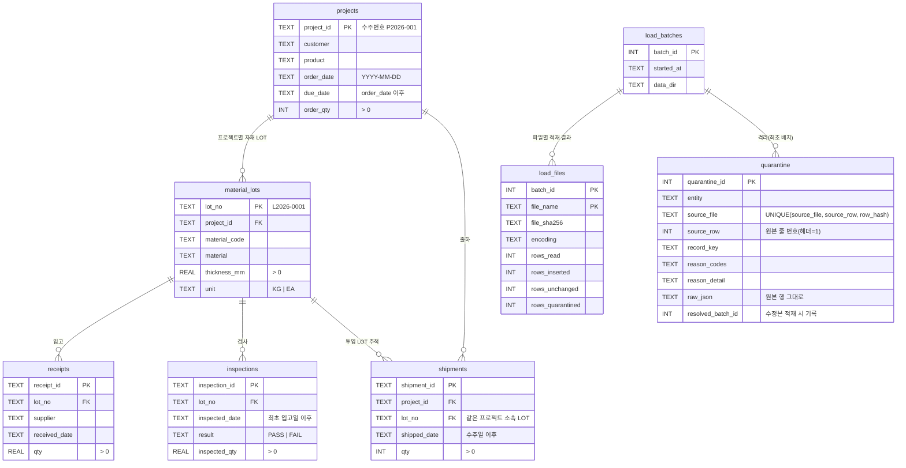

# 과제 01 ERD

모든 업무 테이블(projects ~ shipments)은 위 컬럼 외에 **출처 컬럼**을 함께 가집니다:
`source_file`, `source_row`, `row_hash`, `batch_id`.

조회용 뷰
- `v_broken_relations`: 참조 대상(LOT/프로젝트)이 없어 격리됐고 아직 해결되지 않은 행
- `v_project_lot_summary`: 프로젝트 → LOT → 입고/검사/출하 건수 요약
